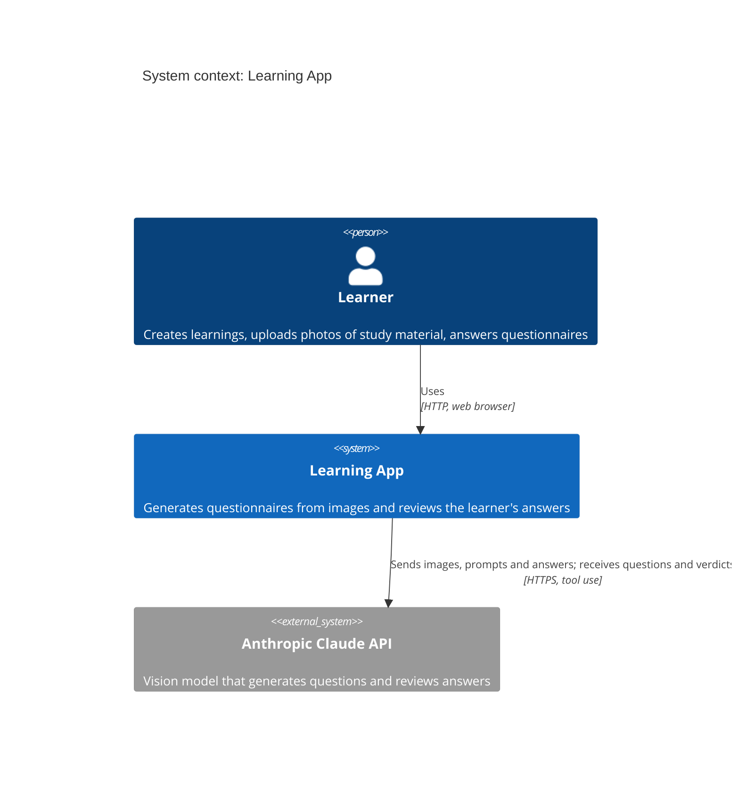
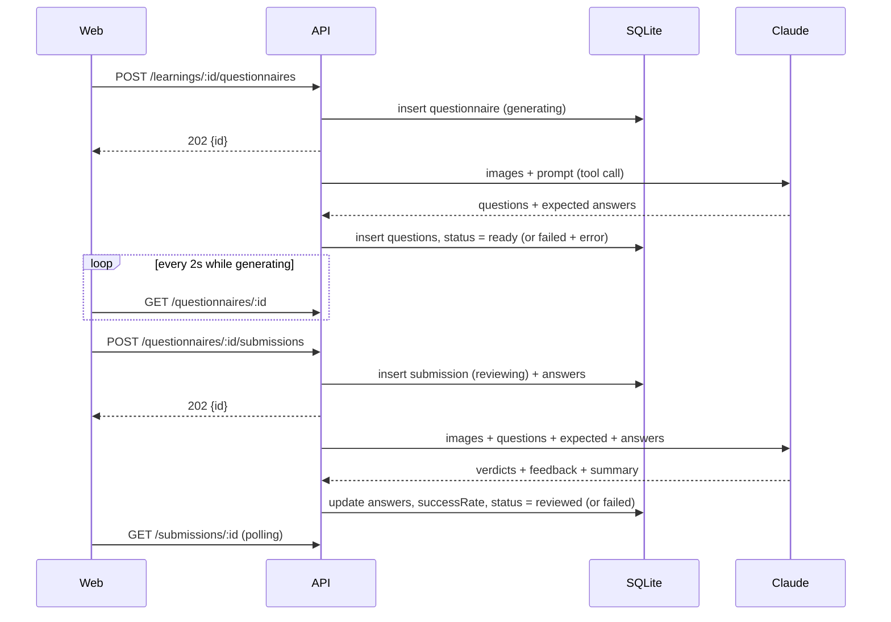
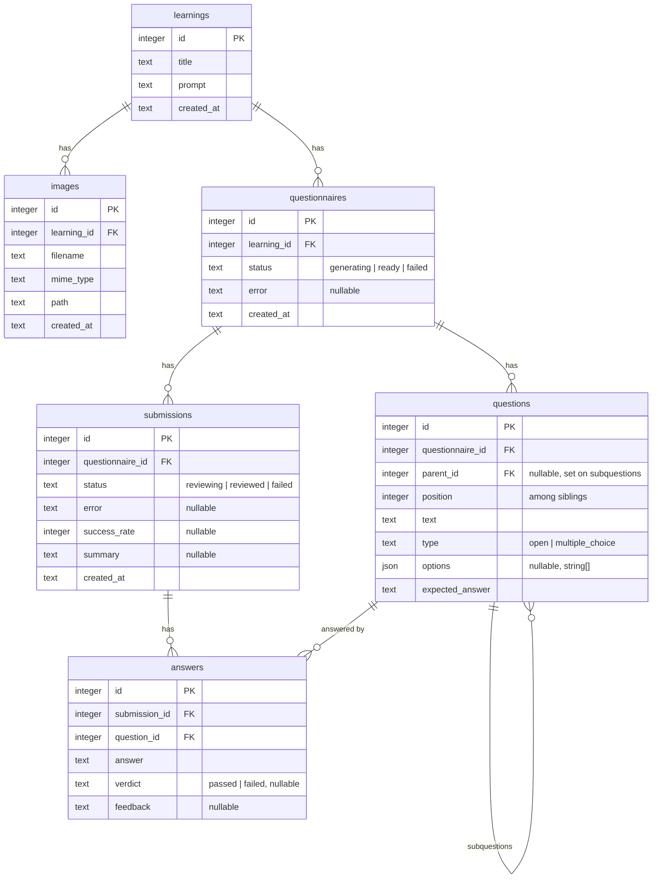

# Architecture

## System context

## Components

- `packages/shared`: Zod schemas and inferred types; the API contract. Consumed as source by both apps.
- `apps/api`: Fastify + better-sqlite3 + Drizzle. Routes in `src/routes/`, Claude calls in `src/claude/client.ts`, job logic in `src/services/questionnaires.ts`. `buildApp({db, claude, uploadsDir})` in `src/app.ts` takes its dependencies as arguments; `src/server.ts` wires real ones.
- `apps/web`: React + Vite + TanStack Query. `src/api/client.ts` is the only code that calls the API. Unsubmitted answers are kept in browser `localStorage` (`features/questionnaires/draftAnswers.ts`), never sent to the server before submit. In dev, Vite listens on all interfaces and proxies `/api` to the API on `:3001`, which itself listens on loopback only (ADR 0010).

## Async flow (questionnaire generation and answer review)

The handlers return 202 immediately and run the Claude call without awaiting it. Errors are caught in the service and stored on the row. At startup `failInterruptedJobs` marks rows still in `generating`/`reviewing` as `failed` (ADR 0009), and `POST /submissions/:id/retry` re-runs the review of a failed submission.

## Data model

`learnings` 1-N `images`; `learnings` 1-N `questionnaires` 1-N `questions`; `questionnaires` 1-N `submissions` 1-N `answers` (each answer points to a question). Questions form a two-level hierarchy through `questions.parent_id`: a task with subquestions is a statement row (empty `expected_answer`, never answered or reviewed) and its subquestions are the answerable rows; a plain task has no children and is answerable itself. `position` is the index among siblings. Answers exist only for answerable rows. All child rows cascade on delete. Statuses: questionnaire `generating|ready|failed`; submission `reviewing|reviewed|failed`; answer verdict `passed|failed|null` (null until reviewed).

## Invariants

- `questions.expected_answer` never leaves the server. `GET /questionnaires/:id` selects fields explicitly and a test asserts it.
- Only answerable questions (no children) get answers, are sent to Claude for review and count in `successRate`. `GET /questionnaires/:id` returns tasks with nested `subquestions`; numbering (1, 2) and lettering (a, b) are derived from `position`.
- `successRate` is computed by `computeSuccessRate` from the verdicts, not taken from Claude. Questions missing from Claude's review count as failed.
- The table definitions exist twice: Drizzle in `apps/api/src/db/schema.ts` and the raw DDL in `apps/api/src/db/index.ts`. Change both.
- Images live on disk under `uploads/<learningId>/`; the DB stores the path. HEIC/HEIF uploads are converted to JPEG with `heic-convert` (pure JS) in the upload route, so only JPEG, PNG, GIF and WebP are ever stored, served or sent to Claude.
- Logging: pino JSON lines to stdout and `LOG_FILE` (default `apps/api/logs/api.log`), level from `LOG_LEVEL` (default `info`); see ADR 0007. Jobs log with the request's `req.log`, and each Claude call logs duration, `stop_reason` and token usage. No prompts, answers or image data are logged.
- Claude calls use `max_tokens` 16000 and fail with an explicit error when `stop_reason` is `max_tokens`. A 4096 limit truncated questionnaires built from several textbook pages, which showed up as a Zod "questions: expected array" error.
