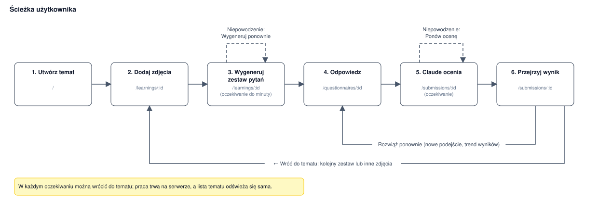
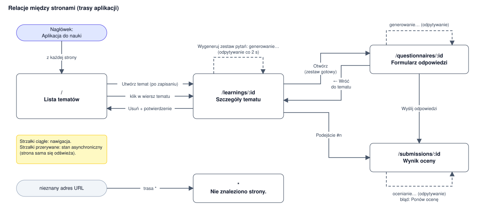
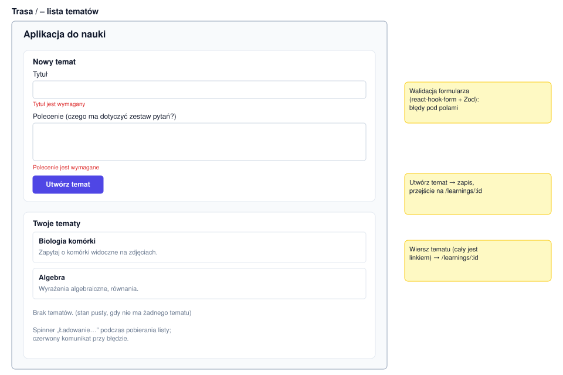
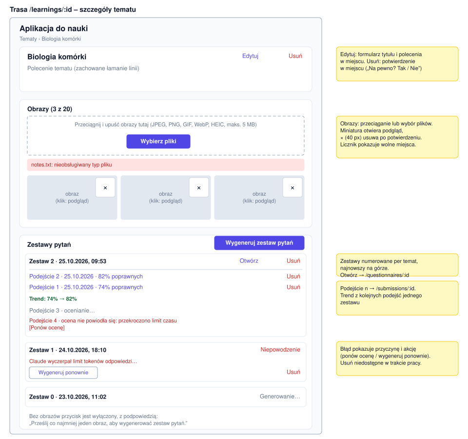
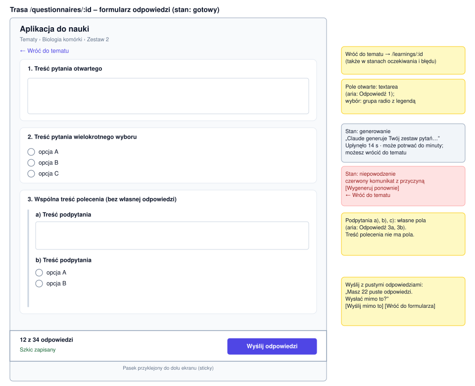
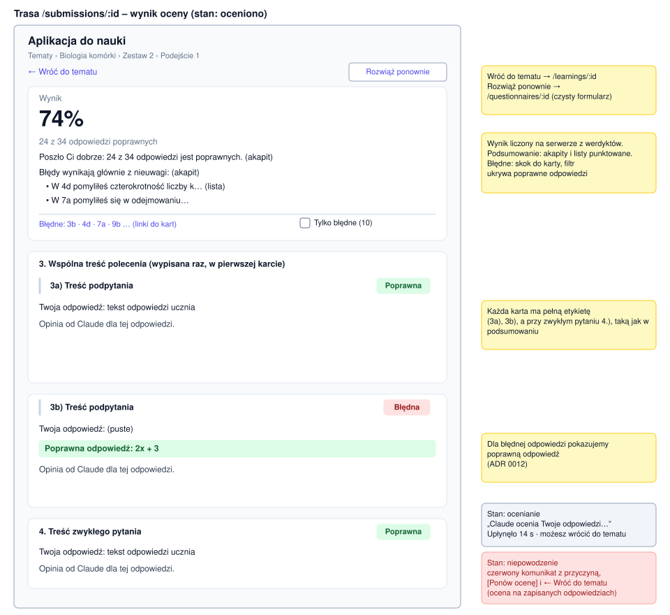
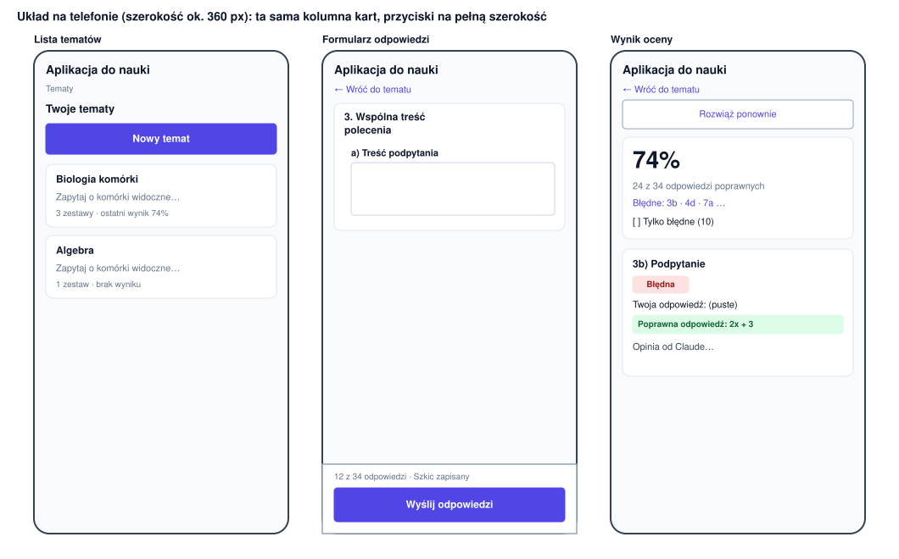

# UI layout

Layout of the web app (`apps/web`) and how its pages connect. Diagrams are draw.io files in `docs/diagrams/`; labels in them are the real Polish UI texts (NFR-7). Design first: change this file and the diagrams before changing a page, route or navigation, and keep them in sync with the implementation.

## Shell and conventions

Every page renders inside one shell (`App.tsx`): a centred column (`max-w-3xl`, 16 px side padding) with a header, breadcrumbs and the routed page.

```text
+--------------------------------------------------+
| [Aplikacja do nauki]  <- link to "/"             |
| Tematy › Biologia komórki › Zestaw 2             |  breadcrumbs: every item but the last is a link
+--------------------------------------------------+
| <page content: a vertical stack of cards>        |
+--------------------------------------------------+
```

- **Card** (`components/ui.tsx`): white rounded box with a border; the unit all pages are built from.
- **Breadcrumbs**: `Tematy › <topic> › Zestaw n › Podejście m`; a page shows the trail down to itself. Every page has a way back to its parent (breadcrumb or "← Wróć do tematu"), also in the waiting and failed states.
- **Focus**: after navigation the focus moves to the main region, so keyboard and screen-reader users start at the top.
- **Waiting notice**: while Claude works, the page shows the status text, the elapsed time and the hint that it can take up to a minute and that leaving is safe (the work continues on the server). The page refetches every 2 s (TanStack Query `refetchInterval`) and swaps its content when the status changes; the topic page polls while any set is `generating` or any submission is `reviewing`.
- **ErrorMessage** (`role=alert`): red box with the error text. Failed jobs show the stored reason and the action that fixes it (retry, regenerate).
- **Confirmation**: destructive actions (delete topic, set, submission, image) confirm inline, in place of the button: "Na pewno? [Tak] [Nie]". No `window.confirm`.
- **Numbering**: users never see database ids. Questions use labels (`3`, `3b`); sets are numbered per topic ("Zestaw 1"), submissions per set ("Podejście 1"), by creation order.
- **Touch targets**: controls are at least 40 px high on phones; the layout is the same single column (see Mobile).
- **Forms**: validation errors are tied to their fields (`aria-describedby`); radio groups are `fieldset` + `legend` with the question text.

## User journey



## Page relations



Solid arrows are navigation, labelled with the trigger. Dashed loops are asynchronous states and retries in which the page refreshes itself or the user re-runs a job. Breadcrumbs lead from every page to its parents, so they are not drawn as separate arrows.

Notes:
- A submission opens a new attempt with "Rozwiąż ponownie" (clean form of the same set); results of all attempts of a set are listed on the topic page with their trend.
- Questionnaire and submission pages also open by direct URL.

## Pages

### 1. Topic list: `/`



- The list comes first. "Nowy temat" reveals the create form above the list; with no topics the form is open and the empty state explains the three steps.
- Each row shows title, a one-line prompt, the number of sets and the last result.

### 2. Topic detail: `/learnings/:id`



- "Edytuj" turns title and prompt into the create form in place; "Usuń" confirms inline.
- Images: counter `(n z 20)`, miniatures open a preview dialog, the remove button is 40 px and confirms inline.
- "Zestawy pytań" starts with the generation options: a checkbox per category used so far (preselected: those failed in the latest reviewed attempt) and "Liczba pytań" (1-30, default 10), then "Wygeneruj zestaw pytań". It is disabled when no category is ticked or the count is invalid. A set generated for chosen categories lists them ("Kategorie: …").
- Sets are numbered per topic, newest first, each with date, status, "Otwórz", "Usuń" (not while generating). A failed set shows the reason and "Wygeneruj ponownie".
- Submissions are listed under their set with date and result; a trend (`74% → 82%`) appears with two or more reviewed attempts. A failed review shows the reason and "Ponów ocenę".

### 3. Questionnaire: `/questionnaires/:id`

Three states share the route: generating (waiting notice and back link), failed (error with the reason, "Wygeneruj ponownie", back link) and ready (the form below).



- A sticky bar at the bottom shows progress ("12 z 34 odpowiedzi"), the draft indicator ("Szkic zapisany") and the submit button.
- Submitting with empty answers first asks inline: "Masz N pustych odpowiedzi. Wysłać mimo to?".
- The draft is saved to `localStorage` whenever focus leaves an input and cleared after a successful submit.

### 4. Submission: `/submissions/:id`

Three states share the route: reviewing (waiting notice and back link), failed (error with the reason, "Ponów ocenę", back link) and reviewed (the result below).



- Top row: "← Wróć do tematu" and "Rozwiąż ponownie".
- The result card has a table "Wyniki według kategorii" (category, passed z total, percent). Each answer card starts with its category as a small caption.
- The summary renders paragraphs and `- ` bullet lists. Below it, a jump list of the failed labels and the filter "Tylko błędne".
- Every card carries the full label (`3b)`, `4.` for a plain question), the same as in the summary; the statement of a question with subquestions is printed once, in its first card.
- A failed answer shows the correct answer ("Poprawna odpowiedź: …", ADR 0012).

### 5. Not found: `*`

The shell (header link) with the single line "Nie znaleziono strony." below it. No separate diagram; it appears in the page relations diagram.

Pages 2 to 4 show an `ErrorMessage` ("Nie znaleziono" or the API error) when the id does not exist.

## Mobile



The same single column on a phone: buttons span the full width, the sticky submit bar stays at the bottom of the screen, and result badges move below the question title when the line is too narrow.

## Editing diagrams

The files in `docs/diagrams/` are `.drawio.svg`: ordinary SVG images (so they show in Markdown and on GitHub) that also embed the editable draw.io diagram. To change one, open it in draw.io (app.diagrams.net, the desktop app, or the VS Code "Draw.io Integration" extension), edit, and save in place with the same file name and format. Keep the labels in sync with the real UI texts.
